# Guia de uso do MACH1 custom app

Este guia mostra cada parte do app, com imagens da versão 1.0.1 rodando em um Ryzen 7 9800X3D com a tela IRV360. Para instalar, compilar e ver a lista de argumentos, volte ao [README](../README.md).

- [Instalação e primeira abertura](#instalação-e-primeira-abertura)
- [A janela](#a-janela)
- [Tela do water cooler](#tela-do-water-cooler)
- [Editor de layout](#editor-de-layout)
- [Processador](#processador)
- [Benchmark](#benchmark)
- [Ventoinhas e bomba](#ventoinhas-e-bomba)
- [Geral](#geral)
- [Bandeja e encerramento](#bandeja-e-encerramento)
- [Onde ficam os seus dados](#onde-ficam-os-seus-dados)
- [Solução de problemas](#solução-de-problemas)

## Instalação e primeira abertura

1. Baixe o `MACH1-custom-app-setup-<versão>.exe` na página de releases do repositório e execute.
2. O Windows SmartScreen pode avisar, porque o instalador não é assinado: clique em "Mais informações" e depois em "Executar assim mesmo".
3. O instalador copia o app com o .NET junto, instala o driver PawnIO se ele ainda não estiver na máquina e coloca um `ffmpeg.exe` ao lado do app. Ele oferece duas opções: atalho na área de trabalho e abrir junto com o Windows.
4. Feche o MACH1-LCD do fabricante antes de abrir o app. Os dois programas não conseguem usar a tela ao mesmo tempo.
5. Abra o MACH1 custom app. O Windows pede permissão de administrador a cada abertura, porque o app fala direto com o processador e com o chip de ventoinhas da placa-mãe.

## A janela

O topo mostra o nome do processador, a geração, o número de núcleos e a temperatura atual do processador e da placa de vídeo. Abaixo ficam as cinco abas. A linha no rodapé mostra a última ação feita pelo app.

O app abre na aba **Tela do water cooler**.

## Tela do water cooler

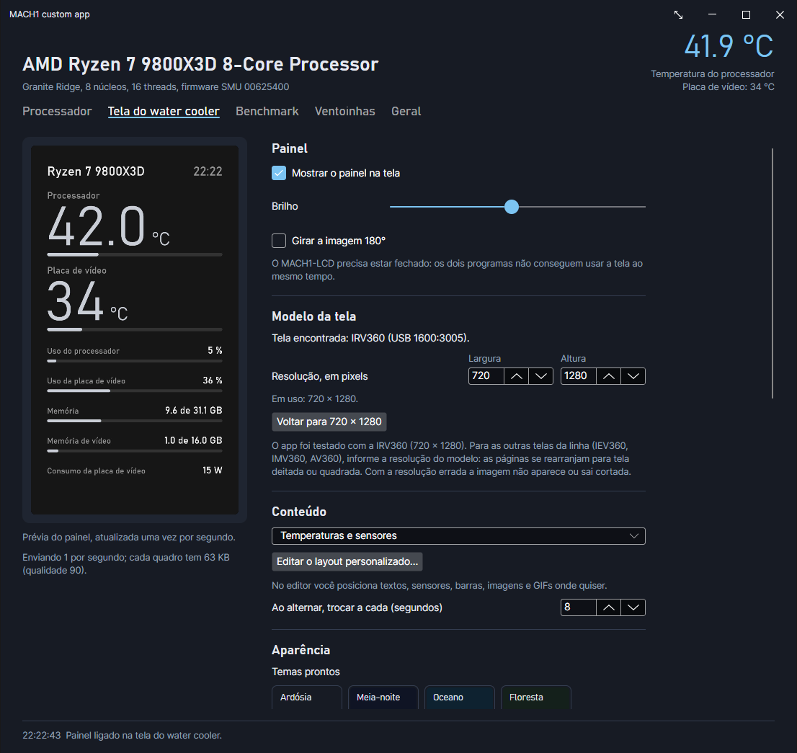

À esquerda fica a prévia do que está sendo enviado para a tela, atualizada uma vez por segundo. Embaixo dela o app informa quantos quadros por segundo está enviando e o tamanho de cada um.

**Painel**

- **Mostrar o painel na tela** liga e desliga o envio.
- **Brilho** vai de 5 a 100. O mínimo existe para a tela não ficar apagada por engano.
- **Girar a imagem 180°** serve para quem montou o bloco de cabeça para baixo.

**Modelo da tela**

O app procura a tela pelo fabricante no USB e mostra o que encontrou. A IRV360 usa 720 x 1280. Para as outras telas da linha (IEV360, IMV360, AV360), informe a resolução do modelo: as páginas se rearranjam para tela em pé, deitada ou quadrada.

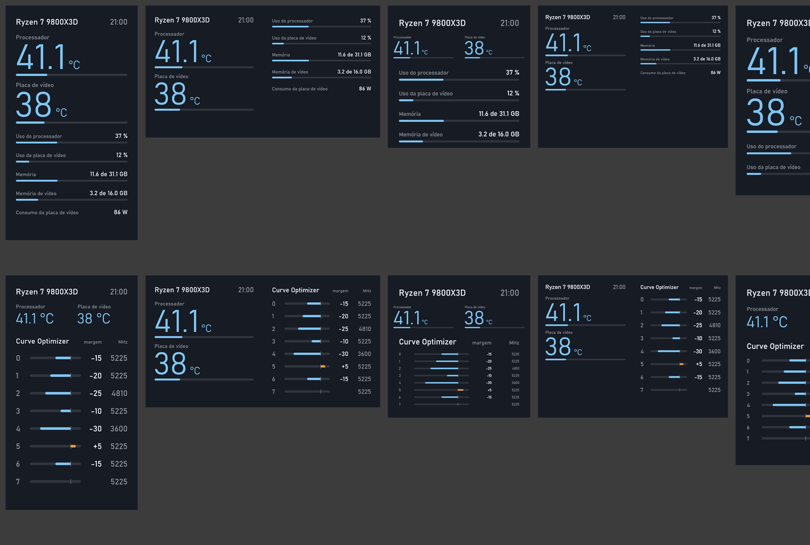

Só a IRV360 foi testada em hardware. As outras resoluções foram verificadas pela prévia.

**Conteúdo**

Há três páginas prontas e uma livre:

- **Temperaturas e sensores**: temperatura do processador e da placa de vídeo, uso, memória, memória de vídeo e consumo da placa de vídeo.
- **Curve Optimizer**: a margem e o clock de cada núcleo.
- **Alternar entre as duas**: troca de página a cada tantos segundos.
- **Layout personalizado**: o que você montar no [editor de layout](#editor-de-layout).

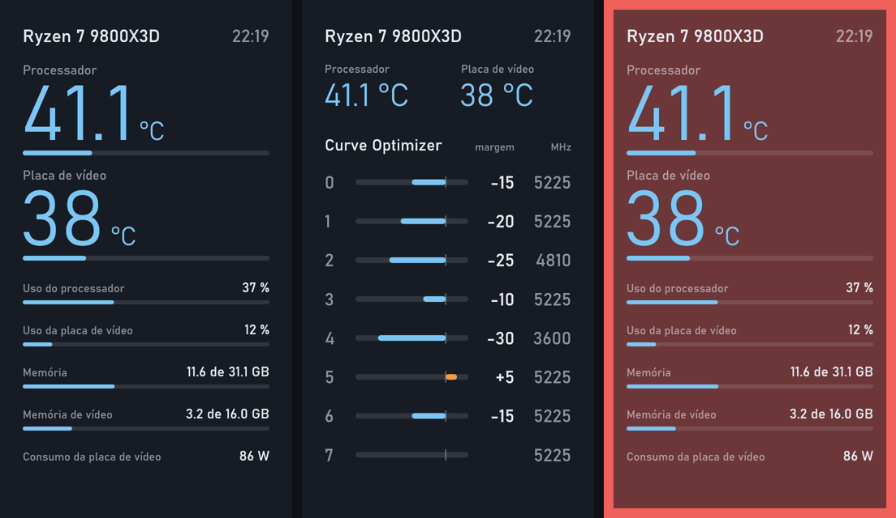

A imagem acima mostra a página de temperaturas, a página do Curve Optimizer e a tela durante um alerta de temperatura.

**Aparência**

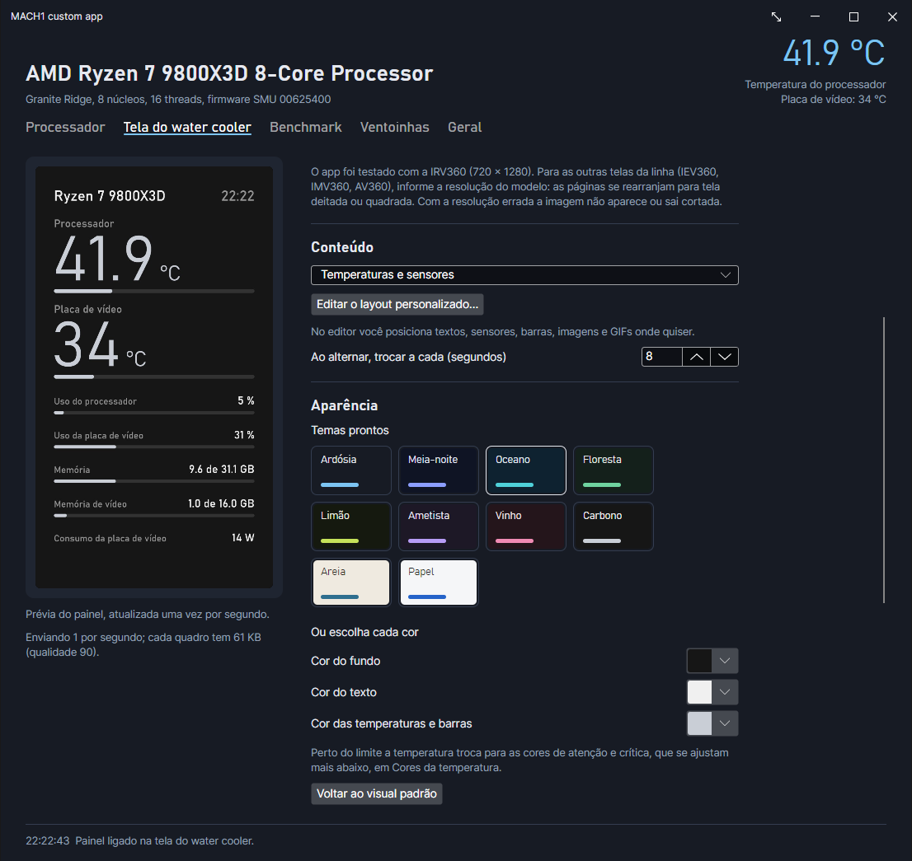

Clique em um dos dez temas prontos ou escolha a cor do fundo, do texto e das temperaturas e barras uma a uma. **Voltar ao visual padrão** desfaz tudo.

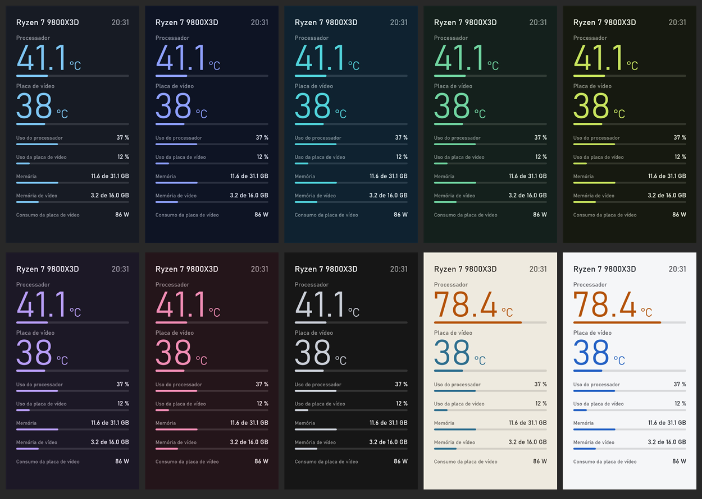

**Fundo com imagem, GIF ou vídeo**

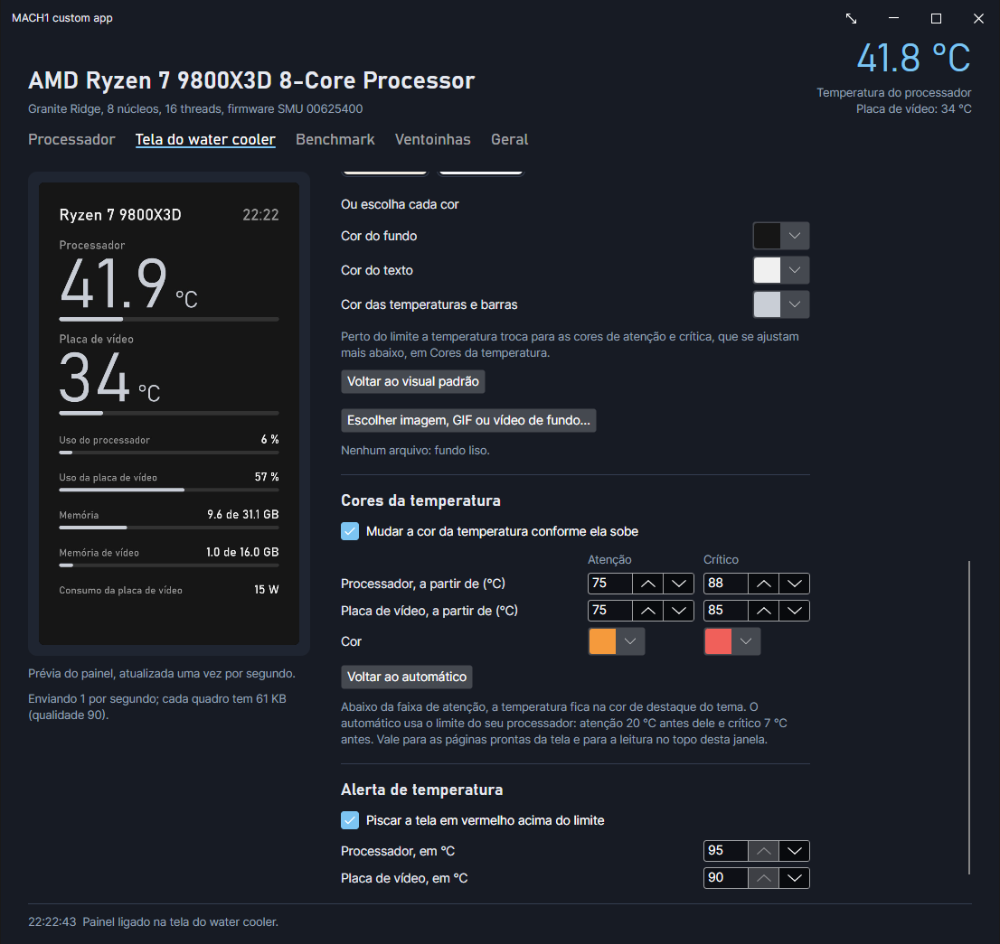

**Escolher imagem, GIF ou vídeo de fundo** aceita imagens, GIFs animados e vídeos como MP4. Com um arquivo escolhido aparecem o botão **Remover** e o controle **Opacidade da cor de fundo sobre a imagem ou o vídeo**: em 0 % aparece só a imagem ou o vídeo; em 100 %, só a cor de fundo. Um valor intermediário mantém os números legíveis sobre um fundo movimentado.

O vídeo depende do `ffmpeg.exe`. O instalador já coloca um ao lado do app; quem compila pelo código precisa de um na pasta do app, no PATH ou na instalação do MACH1-LCD.

A tela recebe os quadros por USB a cerca de 1,4 MB por segundo. Com fundo animado o app reduz a qualidade de cada quadro até caber nesse limite, então um vídeo muito detalhado fica com menos nitidez ou menos quadros por segundo.

**Cores da temperatura**

Com a opção ligada, a temperatura muda de cor ao passar de dois limites: atenção e crítico. Você define os dois limites para o processador e para a placa de vídeo, e as duas cores. **Voltar ao automático** usa o limite do seu processador: atenção 20 °C antes dele e crítico 7 °C antes.

**Alerta de temperatura**

Com a opção ligada, a tela pisca em vermelho quando o processador ou a placa de vídeo passa do limite que você definir.

## Editor de layout

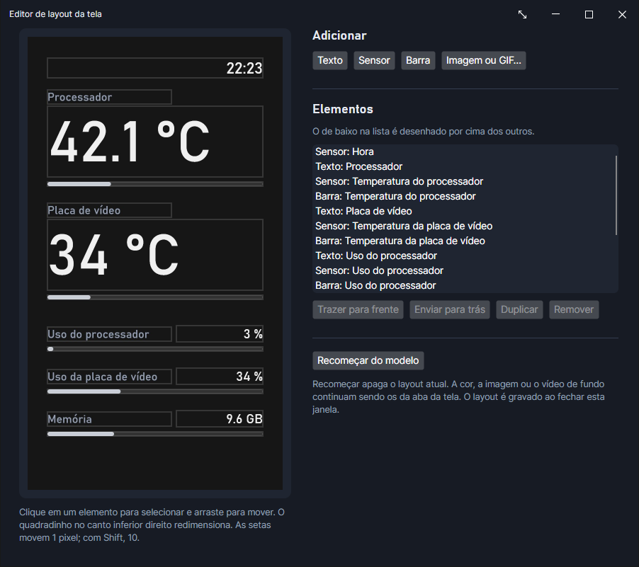

Abra pelo botão **Editar o layout personalizado** na aba da tela. O editor troca o conteúdo da tela para **Layout personalizado**.

- **Adicionar** cria um texto, um sensor, uma barra ou uma imagem ou GIF.
- Clique em um elemento para selecionar e arraste para mover. O quadradinho no canto inferior direito redimensiona.
- As setas do teclado movem 1 pixel; com Shift, 10.
- A lista **Elementos** mostra a ordem de desenho: o de baixo fica por cima. Use **Trazer para frente**, **Enviar para trás**, **Duplicar** e **Remover**.
- **Recomeçar do modelo** apaga o layout atual e volta ao modelo inicial.

O layout é gravado ao fechar a janela do editor. A cor, a imagem ou o vídeo de fundo continuam sendo os da aba da tela.

## Processador

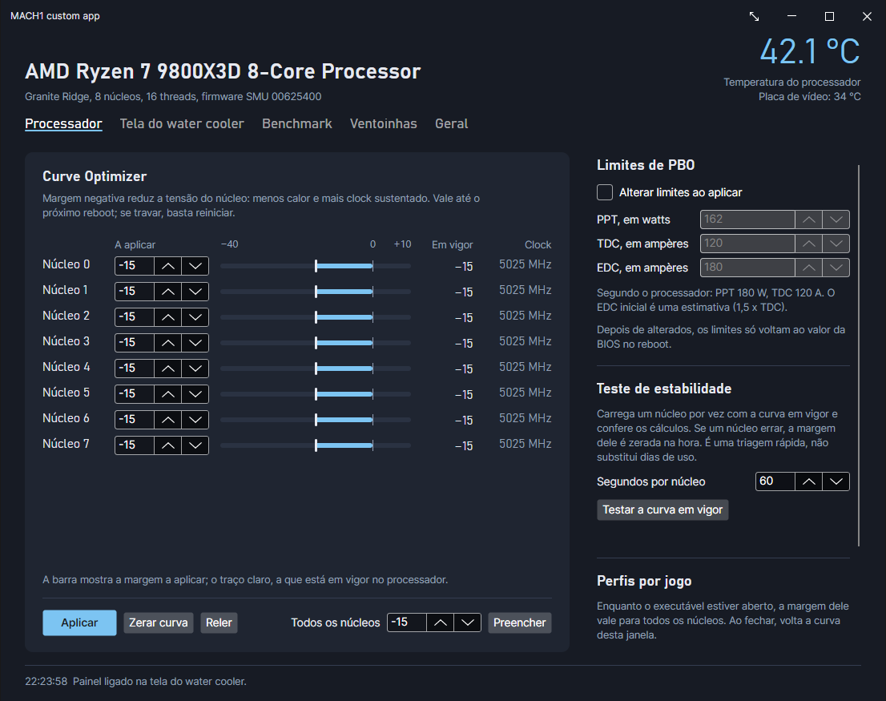

Esta aba fala direto com o SMU do processador. Nada é gravado na BIOS: tudo vale até o próximo reboot. Se o PC travar com uma margem agressiva demais, basta reiniciar.

**Curve Optimizer** (Ryzen da série 5000 em diante)

- Cada núcleo tem uma margem, de -40 a +10 em Zen 4 e Zen 5 e de -30 a +10 nos anteriores. Margem negativa reduz a tensão do núcleo: menos calor e mais clock sustentado.
- A barra mostra a margem a aplicar; o traço claro, a que está em vigor no processador. As colunas à direita mostram a margem em vigor e o clock de cada núcleo.
- **Aplicar** envia a curva. **Zerar curva** volta todos a zero. **Reler** lê o que está em vigor. **Preencher** copia um valor para todos os núcleos.

**Limites de PBO**

Marque **Alterar limites ao aplicar** para mudar PPT, TDC e EDC. Os valores iniciais vêm do próprio processador. Depois de alterados, eles só voltam ao valor da BIOS no reboot.

**Teste de estabilidade**

Carrega um núcleo por vez com a curva em vigor e confere os cálculos. Se um núcleo errar, a margem dele é zerada na hora. É uma triagem rápida e não substitui dias de uso.

**Perfis por jogo**

Informe o nome do executável, por exemplo `cs2.exe`, e uma margem. Enquanto o executável estiver aberto, essa margem vale para todos os núcleos. Ao fechar o jogo, volta a curva da janela. Funciona também com o app na bandeja.

**Em outros processadores**

- Ryzen anterior à série 5000: só os limites de PBO. A curva, o teste e os perfis por jogo ficam desabilitados, com um aviso.
- Intel e demais: a aba fica desabilitada. O restante do app funciona.

## Benchmark

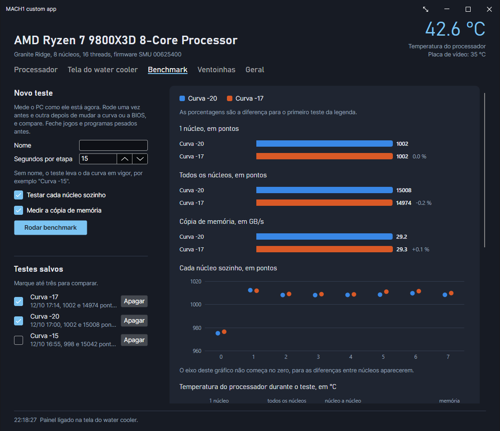

O benchmark mede o PC como ele está agora. A ideia é rodar uma vez antes e outra depois de mudar a curva ou a BIOS e comparar.

1. Feche jogos e programas pesados.
2. Dê um nome ao teste. Sem nome, ele leva o da curva em vigor, como "Curva -15".
3. Escolha os segundos por etapa e se quer testar cada núcleo sozinho e a cópia de memória.
4. Clique em **Rodar benchmark**.

Os testes ficam salvos na lista. Marque até três para comparar:

- **1 núcleo** e **todos os núcleos**, em pontos, com a diferença em porcentagem para o primeiro teste da legenda.
- **Cópia de memória**, em GB/s.
- **Cada núcleo sozinho**. O eixo deste gráfico não começa no zero, para as diferenças entre núcleos aparecerem.
- **Temperatura** e **clock efetivo** ao longo do teste, com as etapas marcadas.

A pontuação é uma escala própria do app, com cerca de 1000 pontos para um núcleo do 9800X3D. Ela serve para comparar o mesmo PC antes e depois de um ajuste, e não para comparar com outros programas de benchmark.

**Salvar os gráficos como imagem** grava a comparação em um PNG.

## Ventoinhas e bomba

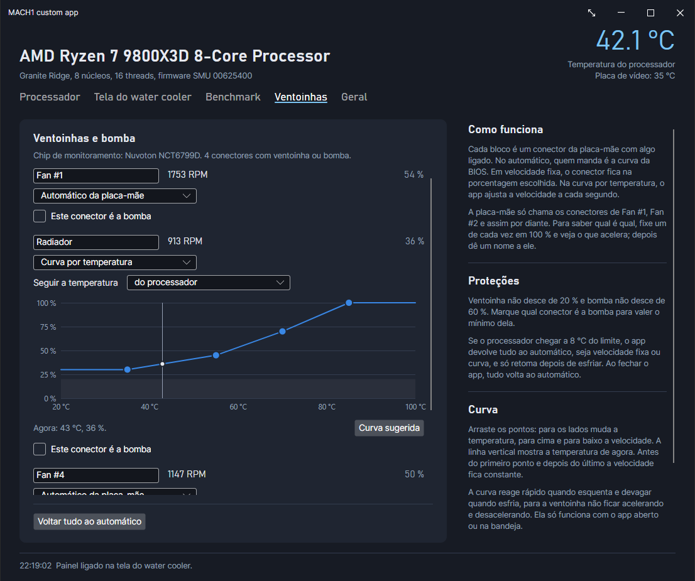

Cada bloco é um conector da placa-mãe com algo ligado. O app mostra a rotação e a velocidade atual, e você escolhe quem manda em cada conector:

- **Automático da placa-mãe**: a curva da BIOS. É o padrão.
- **Velocidade fixa**: o conector fica na porcentagem escolhida.
- **Curva por temperatura**: o app ajusta a velocidade a cada segundo, seguindo a temperatura do processador ou da placa de vídeo.

**Descobrir qual conector é qual**

A placa-mãe só chama os conectores de Fan #1, Fan #2 e assim por diante. Fixe um de cada vez em 100 %, veja o que acelera e dê um nome a ele no campo do topo do bloco. Marque **Este conector é a bomba** no conector da bomba.

**Desenhar a curva**

Arraste os pontos: para os lados muda a temperatura, para cima e para baixo a velocidade. A linha vertical mostra a temperatura de agora. Antes do primeiro ponto e depois do último a velocidade fica constante. **Curva sugerida** volta a uma curva inicial.

A curva reage rápido quando esquenta e devagar quando esfria, para a ventoinha não ficar acelerando e desacelerando.

**Proteções**

- Ventoinha não desce de 20 % e bomba não desce de 60 %.
- Se o processador chegar a 8 °C do limite dele, o app devolve tudo ao automático e só retoma depois de esfriar.
- Ao sair do app, tudo volta ao automático.
- **Voltar tudo ao automático** faz isso na hora.

**Limites**

- A velocidade fixa e a curva só funcionam com o app aberto ou na bandeja.
- O app só alcança o que está ligado na placa-mãe. Ventoinhas com controlador próprio, como as sem fio da Lian Li, ficam de fora, a menos que o controlador esteja configurado para seguir o sinal da placa-mãe.
- Se o app for encerrado à força com um conector sob o controle dele, o conector fica na última velocidade até o PC reiniciar. Veja [Bandeja e encerramento](#bandeja-e-encerramento).

## Geral

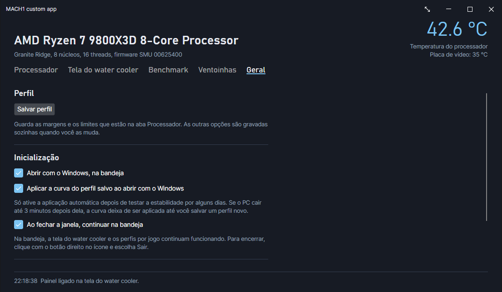

- **Salvar perfil** guarda as margens e os limites da aba Processador. As outras opções são gravadas sozinhas quando você as muda.
- **Abrir com o Windows, na bandeja** cria uma tarefa agendada que abre o app a cada logon, já com permissão de administrador.
- **Aplicar a curva do perfil salvo ao abrir com o Windows** só deve ser ligada depois de alguns dias de uso estável. Se o PC cair até 3 minutos depois da aplicação automática, a curva deixa de ser aplicada até você salvar um perfil novo.
- **Ao fechar a janela, continuar na bandeja** mantém a tela, as ventoinhas e os perfis por jogo funcionando.
- **Reiniciar na BIOS** reinicia direto na tela da BIOS, para você digitar lá os valores que ficaram estáveis e torná-los permanentes.

## Bandeja e encerramento

Com o app na bandeja, clique com o botão direito no ícone: **Abrir** mostra a janela e **Sair** encerra.

Encerre sempre por **Sair** ou por linha de comando:

```bash
Mach1CustomApp.exe --quit
```

Não finalize o processo pelo Gerenciador de Tarefas. Ao sair do jeito normal o app devolve as ventoinhas e a bomba à placa-mãe; encerrado à força, o conector que estava em velocidade fixa ou curva fica na última velocidade até o PC reiniciar. Na abertura seguinte o app avisa e mantém esse conector sob controle.

## Onde ficam os seus dados

Tudo fica em `%AppData%\Mach1CustomApp`:

| Arquivo | Conteúdo |
| --- | --- |
| `profile.json` | Curva, limites, opções da tela, layout, ventoinhas e jogos |
| `benchmarks.json` | Histórico de testes |
| `crash.log` | Registro de erros, se houver |

Desinstalar o app não apaga essa pasta nem o driver PawnIO.

## Solução de problemas

**"Tela não encontrada"**

Feche o MACH1-LCD do fabricante e confira o cabo USB do bloco. O app tenta de novo sozinho a cada 5 segundos.

**A tela está preta ou sem imagem**

Confira o **Brilho** e se **Mostrar o painel na tela** está marcado. Em uma tela que não seja a IRV360, confira a resolução em **Modelo da tela**: com a resolução errada a imagem não aparece ou sai cortada.

**A imagem está de cabeça para baixo**

Marque ou desmarque **Girar a imagem 180°**.

**O vídeo de fundo está lento**

O limite é o USB da tela. Use um vídeo com menos detalhe e movimento.

**O vídeo de fundo não aparece**

Falta o `ffmpeg.exe`. Coloque um na pasta do app.

**A temperatura do processador não aparece, ou a aba Processador está desabilitada**

Instale o driver PawnIO e abra o app de novo:

```bash
winget install namazso.PawnIO
```

**O PC travou depois de aplicar uma curva**

Reinicie: a curva não fica gravada. Use uma margem menos negativa no núcleo que falhou. Se a aplicação automática estava ligada, o app a bloqueia sozinho depois de uma queda logo após o logon.

**Uma ventoinha ficou presa em uma velocidade**

O app foi encerrado à força. Reinicie o PC para a placa-mãe retomar o conector.

**Uma ventoinha não aparece**

Ela não está ligada a um conector da placa-mãe, ou o chip de monitoramento da placa não é reconhecido pela LibreHardwareMonitor.

**O app fechou sozinho**

Veja o `crash.log` em `%AppData%\Mach1CustomApp` e abra uma issue no repositório com o conteúdo dele.
